<picture>
  <source media="(prefers-color-scheme: dark)" srcset="assets/hero-dark.svg" />
  
</picture>

[Portfolio](https://nicho-dev.vercel.app) &nbsp;·&nbsp; [Email](mailto:neckolescano36@gmail.com) &nbsp;·&nbsp; [kuwaGO](https://neckolescano.github.io/kuwaGO/)

 

<picture>
  <source media="(prefers-color-scheme: dark)" srcset="assets/label-work-dark.svg" />
  
</picture>

<a href="https://github.com/neckolescano/kuwaGO">
  <picture>
    <source media="(prefers-color-scheme: dark)" srcset="assets/work-kuwago-dark.svg" />
    
  </picture>
</a>
<a href="https://github.com/neckolescano/IT12_cinematheque">
  <picture>
    <source media="(prefers-color-scheme: dark)" srcset="assets/work-cinematheque-dark.svg" />
    
  </picture>
</a>
<a href="https://github.com/neckolescano/xpera">
  <picture>
    <source media="(prefers-color-scheme: dark)" srcset="assets/work-xpera-dark.svg" />
    
  </picture>
</a>

 

<picture>
  <source media="(prefers-color-scheme: dark)" srcset="assets/label-skills-dark.svg" />
  
</picture>

<picture>
  <source media="(prefers-color-scheme: dark)" srcset="assets/skills-dark.svg" />
  
</picture>
