

  

  <a href="https://nicho-dev.vercel.app">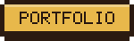</a>
  &nbsp;
  
  &nbsp;
  

 

  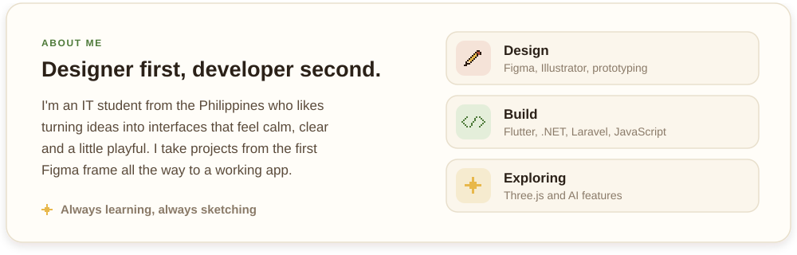

 

  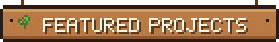

  <a href="https://github.com/neckolescano/kuwaGO">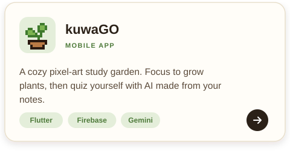</a>
  <a href="https://github.com/neckolescano/xpera">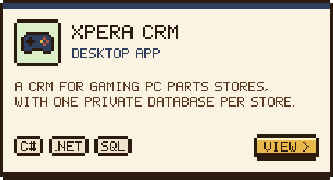</a>
  <a href="https://github.com/neckolescano/Nicho.dev">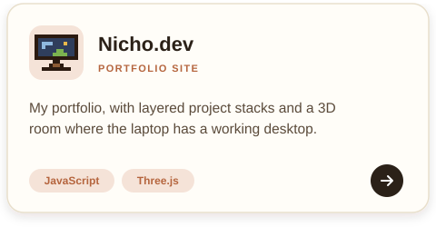</a>
  <a href="https://github.com/neckolescano/IT12_cinematheque">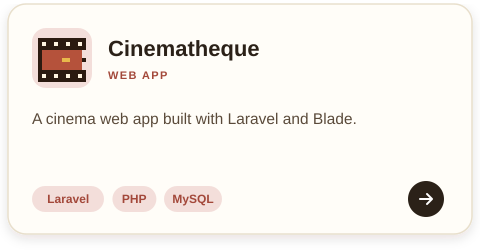</a>
  <a href="https://github.com/neckolescano/sagap">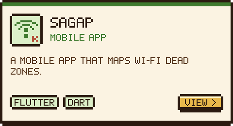</a>
  <a href="https://github.com/neckolescano/IT5-payroller">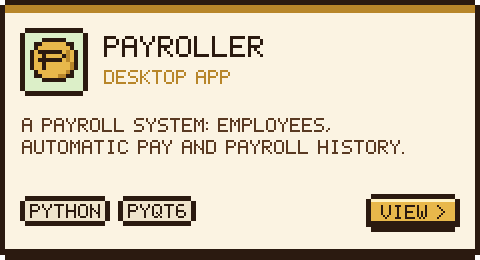</a>

 

  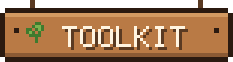

  

 

  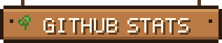

  
  

  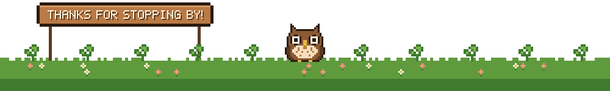

