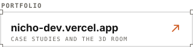
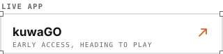

<a href="https://nicho-dev.vercel.app"><picture><source media="(prefers-color-scheme: dark)" srcset="./assets/hero-dark.svg" /><source media="(prefers-color-scheme: light)" srcset="./assets/hero-light.svg" /></picture></a>

  <a href="https://nicho-dev.vercel.app"><picture><source media="(prefers-color-scheme: dark)" srcset="./assets/nav-portfolio-dark.svg" /><source media="(prefers-color-scheme: light)" srcset="./assets/nav-portfolio-light.svg" /></picture></a>
  <a href="mailto:neckolescano36@gmail.com"><picture><source media="(prefers-color-scheme: dark)" srcset="./assets/nav-email-dark.svg" /><source media="(prefers-color-scheme: light)" srcset="./assets/nav-email-light.svg" /></picture></a>
  <a href="https://neckolescano.github.io/kuwaGO/"><picture><source media="(prefers-color-scheme: dark)" srcset="./assets/nav-kuwago-dark.svg" /><source media="(prefers-color-scheme: light)" srcset="./assets/nav-kuwago-light.svg" /></picture></a>

 

<picture><source media="(prefers-color-scheme: dark)" srcset="./assets/label-work-dark.svg" /><source media="(prefers-color-scheme: light)" srcset="./assets/label-work-light.svg" /></picture>

  <a href="https://github.com/neckolescano/kuwaGO"><picture><source media="(prefers-color-scheme: dark)" srcset="./assets/card-kuwago-dark.svg" /><source media="(prefers-color-scheme: light)" srcset="./assets/card-kuwago-light.svg" /></picture></a>
  &nbsp;
  <a href="https://github.com/neckolescano/IT12_cinematheque"><picture><source media="(prefers-color-scheme: dark)" srcset="./assets/card-cinematheque-dark.svg" /><source media="(prefers-color-scheme: light)" srcset="./assets/card-cinematheque-light.svg" /></picture></a>

  <a href="https://github.com/neckolescano/xpera"><picture><source media="(prefers-color-scheme: dark)" srcset="./assets/card-xpera-dark.svg" /><source media="(prefers-color-scheme: light)" srcset="./assets/card-xpera-light.svg" /></picture></a>
  &nbsp;
  <a href="https://github.com/neckolescano/Nicho.dev"><picture><source media="(prefers-color-scheme: dark)" srcset="./assets/card-nichodev-dark.svg" /><source media="(prefers-color-scheme: light)" srcset="./assets/card-nichodev-light.svg" /></picture></a>

<b>INDEX // MORE PROJECTS</b> &mdash; expand the full list

 

| No. | Project | Type | What it is | Built with |
| :--- | :--- | :--- | :--- | :--- |
| `05` | [**sagap**](https://github.com/neckolescano/sagap) | Mobile app | Maps Wi-Fi dead zones | `Flutter` `Dart` |
| `06` | [**PayRoller**](https://github.com/neckolescano/IT5-payroller) | Desktop app | Payroll: employee records, pay computation and history | `Python` `PyQt6` `SQLite` |

 

<picture><source media="(prefers-color-scheme: dark)" srcset="./assets/label-skills-dark.svg" /><source media="(prefers-color-scheme: light)" srcset="./assets/label-skills-light.svg" /></picture>

<picture><source media="(prefers-color-scheme: dark)" srcset="./assets/skills-dark.svg" /><source media="(prefers-color-scheme: light)" srcset="./assets/skills-light.svg" /></picture>

